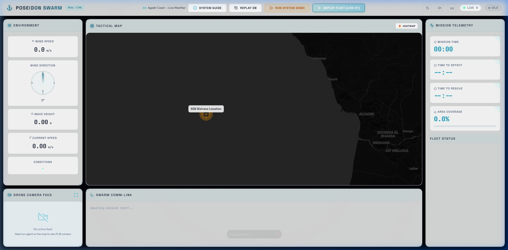
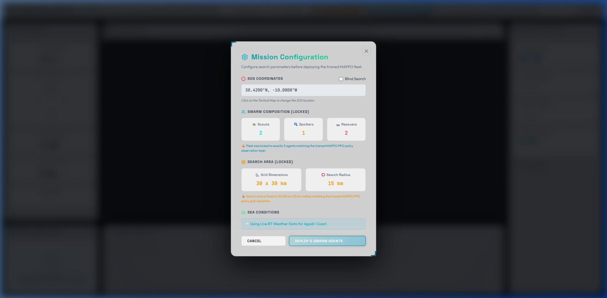
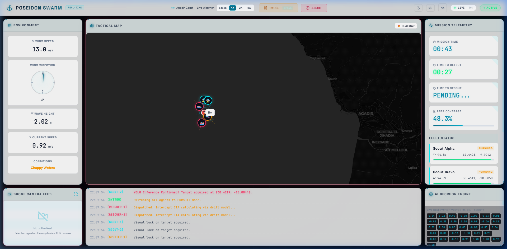

# Poseidon-Swarm: Tactical Command Cockpit & Simulation Engine

Poseidon-Swarm is a cooperative heterogeneous UAV-USV swarm coordination system designed for autonomous maritime Search and Rescue (SAR) operations in stormy sea states. This repository contains the **Tactical Command Dashboard**, comprising a **FastAPI** simulation/inference backend and a high-fidelity **React.js** HUD client.

---

## 🏗️ System Architecture & AI Pipeline

The dashboard functions as the cockpit, communicating with the simulation and inference engine via a 500 ms WebSocket broadcast loop. It integrates three core AI components:

1. **Perception (YOLO11s):** Aerial object detection fine-tuned on the SeaDronesSee maritime benchmark, integrated with VisDrone coastal negatives to suppress shore-based false positives ($mAP@50 = 0.790, Recall = 0.813$). Slicing-Aided Hyper Inference (SAHI) is utilized during inference to inspect 4K camera frames in overlapping $960\times960$ patches, preserving small visual signatures of victims in the water.
2. **Prediction (ONNX Leeway Surrogate):** A regression Multi-Layer Perceptron (MLP) that models leeway wind/current advection physics. It runs at **0.12 ms latency** ($7{,}800\times$ speedup over Monte Carlo simulation) to project the future drift coordinates of the victim over 1, 2, and 5-minute intercept horizons.
3. **Coordination (MAPPO):** Multi-Agent Proximal Policy Optimization (MAPPO) with a Centralized Critic operating under a Dec-POMDP framework. The model governs path planning for a locked 5-agent fleet (2 Scout UAVs, 1 Spotter UAV, 2 Rescuer USVs) to optimize time-to-detect (TTD) and time-to-rescue (TTR) under severe sea conditions.

---

## 📊 Tactical Cockpit Visuals (Light Theme)

| **Main Operational Console** | **Mission Configuration Modal** | **Active Swarm Search Overlay** |
| :---: | :---: | :---: |
|  |  |  |

---

## 🎥 System Demonstration Walkthrough

Below is the recording of the dashboard system in action, demonstrating the walkthrough of the **System Guide** tour and a complete simulation loop run at 4x speed (target detection, leeway prediction update, and USV intercept):

https://github.com/anVSS1/Poseidon-Swarm/raw/main/recordings/mission_recording_1.mp4

*(Note: You can play the embedded video below directly on GitHub, or drag-and-drop the local file `recordings/mission_recording_1.mp4` into your GitHub repository description page to upload it.)*

<video src="recordings/mission_recording_1.mp4" controls width="100%"></video>

---

## 🚀 How to Run Locally

### 1. Backend Setup
1. Navigate to the backend directory:
   ```bash
   cd backend
   ```
2. Create and activate a Python virtual environment:
   ```bash
   python -m venv venv
   source venv/bin/activate  # On Windows: venv\Scripts\activate
   ```
3. Install dependencies:
   ```bash
   pip install -r requirements.txt
   ```
4. Start the FastAPI server:
   ```bash
   python server.py
   ```
   *The backend will run on `http://localhost:8000`.*

### 2. Frontend Setup
1. Navigate to the frontend directory:
   ```bash
   cd ../frontend
   ```
2. Install npm packages:
   ```bash
   npm install
   ```
3. Start the Vite development server:
   ```bash
   npm run dev
   ```
   *The tactical cockpit HUD will be accessible at `http://localhost:5173/`.*

---

## 🔒 Intellectual Property & Models Notice

To protect the core academic and commercial intellectual property of this project, the raw trained weight parameters, checkpoints, and network configurations are git-ignored and excluded from this public release. This includes:
* PyTorch weights and ONNX formats of the fine-tuned **YOLO11s** model (`models/yolo/`).
* Checkpoint files of the **MAPPO** policy networks (`models/rl/`).
* Trained **Drift Predictor MLP** model weights (`models/drift/`).

### Supervision & Academic Credits
This research was conducted as part of a Master of Research thesis supervised by:
* **Supervisor:** Prof. Driss Abada (Faculty of Sciences, Chouaib Doukkali University)
* **Institution:** Department of Computer Science, Faculty of Science, Chouaib Doukkali University, El Jadida, Morocco.

### Contact Information
If you are a researcher, academic evaluator, or prospective collaborator interested in obtaining access to the trained models or evaluation weights, please contact the author directly:
* **Email:** [contact.me.vnvss@gmail.com](mailto:contact.me.vnvss@gmail.com)
* **LinkedIn:** [Anass Ouzaouit](https://www.linkedin.com/in/anass-ouzaouit/)
